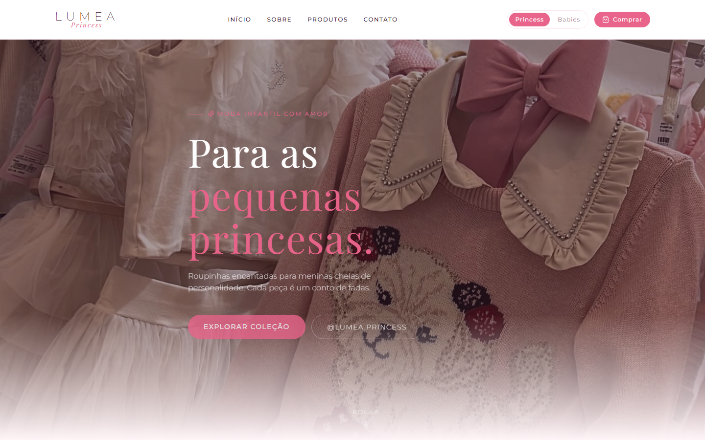
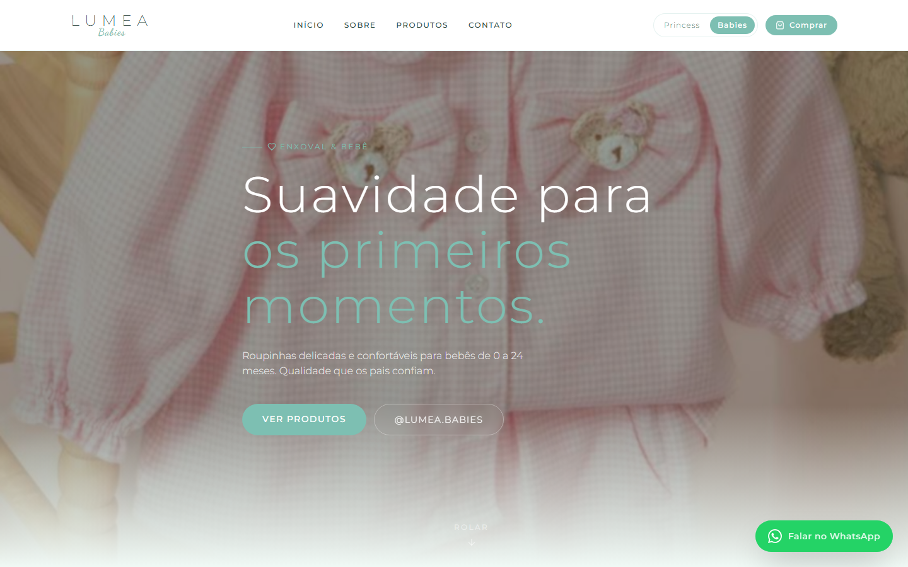
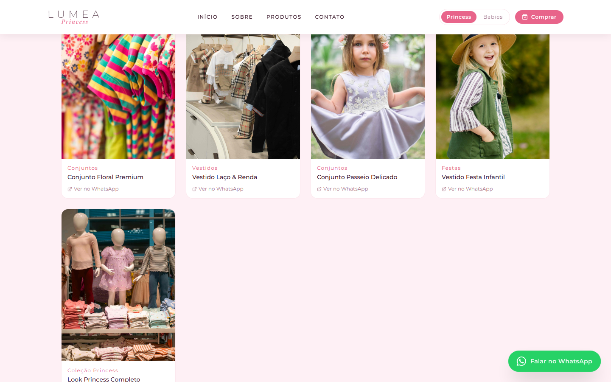
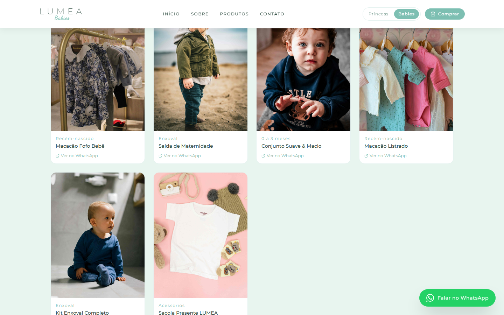
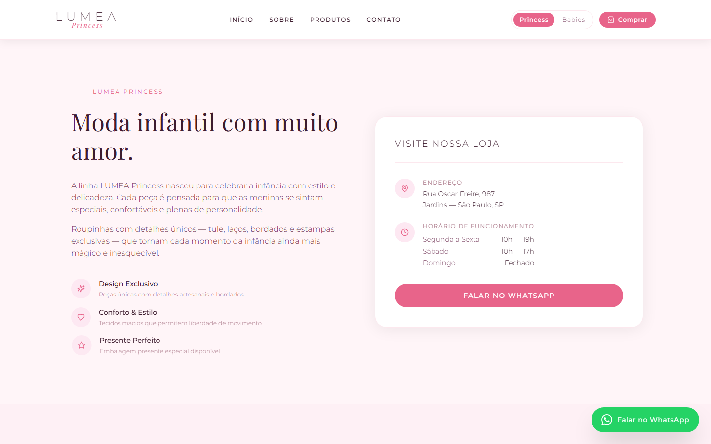

# LUMEA — Landing Page de Moda Infantil

**Landing page com duas identidades visuais completas — moda infantil e enxoval de bebê — alternadas em tempo real na mesma página, sem recarregar.**

## Sobre o projeto

A LUMEA é uma marca fictícia de moda infantil criada como peça de portfólio, inspirada na estrutura de uma loja real do segmento. O projeto resolve um problema comum de pequenas marcas de moda: comunicar duas linhas de produto distintas — infantil e enxoval de bebê — sem dividir a marca em dois sites ou confundir o visitante.

A solução foi um sistema de tema duplo: o visitante alterna entre as linhas **Princess** (moda infantil, paleta rosa/dourada) e **Babies** (enxoval, paleta verde-menta), e toda a página — textos, cores, imagens de produto, catálogo e contato — se adapta instantaneamente, com uma transição animada de cortina entre as trocas.

**Status:** projeto pessoal de portfólio, concluído e publicado. Todos os dados de contato, endereço e redes sociais exibidos são fictícios.

## Prévia

| **Hero — tema Princess** | **Hero — tema Babies** |
|---|---|
|  |  |

| **Vitrine de produtos — Princess** | **Vitrine de produtos — Babies** |
|---|---|
|  |  |

| **Seção Sobre a loja** | |
|---|---|
|  | |

## Funcionalidades

**Identidade dual**
- Alternância entre os temas Princess e Babies via seletor no header, com transição animada de cortina (Framer Motion)
- Paleta de cores, tipografia de destaque, copy e imagens de fundo trocam de acordo com o tema ativo
- Preferência de tema refletida em toda a página: hero, catálogo, seção "Sobre" e rodapé

**Catálogo de produtos**
- Grid de produtos responsivo, com categoria, nome e imagem de cada peça
- Catálogo filtrado automaticamente pelo tema ativo (coleção Princess ou Babies)
- Botão "Ver no WhatsApp" por produto, que abre uma conversa já preenchida com o nome da peça

**Conversão e contato**
- Botão flutuante de WhatsApp com animação de entrada e pulso contínuo, sempre visível
- CTA de WhatsApp com mensagem pré-formatada em múltiplos pontos da página (hero, produto, rodapé)
- Seção de contato com endereço, horário de funcionamento e link direto para o Instagram do tema ativo

**Institucional**
- Seção "Sobre" com texto, diferenciais e proposta de valor específicos para cada linha de produto
- Rodapé com navegação entre as duas linhas, redes sociais e dados de localização

## Arquitetura e stack

| Camada | Tecnologia |
|---|---|
| Framework | Next.js 14 (App Router), renderização estática (SSG) |
| Linguagem | TypeScript |
| Estilização | Tailwind CSS + CSS custom properties para os tokens de tema |
| Animação | Framer Motion (transição de cortina, microinterações) |
| Ícones | Lucide React |
| Tipografia | Google Fonts — Montserrat, Playfair Display, Dancing Script |
| Hospedagem | Vercel, com deploy automático a cada push na branch `main` |

Não há backend nem banco de dados: o catálogo de produtos é um array estático (`lib/products.ts`) servido via SSG. O estado do tema vive em `ThemeContext` — ao clicar em "Princess" ou "Babies", o contexto dispara a animação de cortina, troca o atributo `data-theme` no elemento raiz e todos os componentes (Hero, Products, About, Footer) re-renderizam lendo as variáveis CSS e o conteúdo correspondentes ao novo tema. Os CTAs de WhatsApp geram links `wa.me` com mensagem pré-preenchida no cliente, sem passar por nenhuma API própria.

## Estrutura do projeto

```
landing-page-lovea/
├── app/
│   ├── layout.tsx            # layout raiz, fontes e metadata
│   ├── page.tsx               # composição da página (Header, Hero, Products, About, Footer)
│   └── globals.css            # tokens de tema (--bg-primary, --accent, etc.) para Princess e Babies
├── components/
│   ├── Header.tsx              # navegação, seletor de tema, CTA de compra
│   ├── Hero.tsx                 # seção de destaque com copy e imagem por tema
│   ├── Products.tsx            # grid de produtos filtrado pelo tema ativo
│   ├── About.tsx                 # seção institucional por linha de produto
│   ├── Footer.tsx                # rodapé com navegação entre temas e contato
│   └── WhatsAppButton.tsx     # botão flutuante de contato
├── contexts/
│   └── ThemeContext.tsx        # estado do tema ativo e animação de transição
├── lib/
│   └── products.ts              # catálogo estático de produtos por tema
├── public/assets/produtos/      # imagens de produto servidas pelo Next.js
└── docs/
    └── portfolio-screenshots/   # screenshots usados neste README
```

## Como rodar localmente

**Pré-requisitos:** Node.js 18 ou superior. Não há variáveis de ambiente obrigatórias — o projeto é totalmente estático, sem backend ou chaves de API.

```bash
# Clone o repositório
git clone https://github.com/silassantos21/landing-page-lovea.git
cd landing-page-lovea

# Instale as dependências
npm install

# Suba o ambiente de desenvolvimento
npm run dev
```

| Serviço | Porta | URL |
|---|---|---|
| Next.js dev server | 3000 | http://localhost:3000 |

Para gerar a build de produção: `npm run build` seguido de `npm run start`.

---

Projeto pessoal de portfólio, desenvolvido por Silas Santos.
